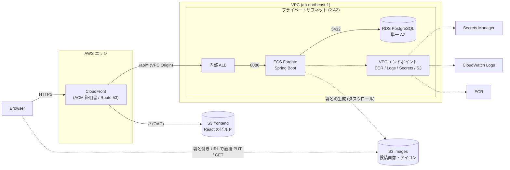

# RaiseTimeLine インフラ構成図

Oct 20, 2026 · @tamura (Fargate 構成へ改訂: Nov 13, 2026)

## 1. 前提と構成図

AWS でサーバーを構築するかはまだ決めていません。構築する場合はこの構成を前提にして、アプリの設計を進めます(S3 の利用だけが確定です)。EC2 は使わず、画面は S3 + CloudFront、API は ECS Fargate で動かします。

画面(React のビルド)は CloudFront が S3 から返し、API は同じドメインの `/api/*` で CloudFront から内部 ALB を通して Fargate へ渡します。ブラウザから見ると画面と API が同じオリジンなので、CORS の設定は要らず、リフレッシュトークンの Cookie(`Path=/api/auth`)もそのまま届きます。画像のバイト列だけは、署名付き URL によってブラウザと S3 が直接やり取りし、Fargate を通りません。Fargate から S3 への通信は、S3 用の VPC エンドポイント(ゲートウェイ型)を通し、インターネットに出ません。

## 2. 各部品の役割とセキュリティグループ

| 部品 | 役割 | 備考 |
| --- | --- | --- |
| CloudFront | インターネットからの入口。HTTPS を受け、`/*` は S3、`/api/*` は内部 ALB へ振り分ける | 証明書(ACM)は us-east-1 に置く。独自ドメインは Route 53 で割り当てる |
| S3(frontend) | React のビルド(`frontend/dist/`)の置き場 | パブリックアクセスをすべてブロックし、CloudFront の OAC からだけ読ませる |
| 内部 ALB | CloudFront(VPC Origin)から API を受け、Fargate のタスクへ渡す | インターネットに公開しない。2 つ以上の AZ のサブネットが必要 |
| ECS Fargate | Spring Boot の API を動かす | `backend/Dockerfile` で作ったイメージを使う。プライベートサブネットに置く。起動時に Flyway がマイグレーションを実行する |
| ECR | Spring Boot のコンテナイメージの保管 | CI から push する |
| RDS | PostgreSQL 16。users・posts などを保存する | プライベートサブネット。DB サブネットグループに 2 つの AZ のサブネットを登録する |
| S3(images) | 投稿画像とアイコンの保存 | パブリックアクセスをすべてブロック。ブラウザは署名付き URL でアクセスする。frontend とは別のバケット |
| VPC エンドポイント | Fargate から ECR・CloudWatch Logs・Secrets Manager・S3 への通信を、VPC の内側で完結させる | ECR(api / dkr)・Logs・Secrets Manager はインターフェイス型(時間料金あり)、S3 はゲートウェイ型(無料)。NAT Gateway は置かない |
| Secrets Manager | `JWT_SECRET` と DB のパスワードを保管し、タスク定義から環境変数として渡す | コードや設定ファイルに置かない |
| CloudWatch Logs | Fargate の標準出力(1 行 1 JSON のログ)を集める | awslogs ドライバを使う |
| IAM タスクロール | 画像用バケットだけに PutObject / GetObject / DeleteObject を許可する | アクセスキーをコードや設定ファイルに置かない |

**CloudFront のビヘイビア**

| パス | オリジン | キャッシュ | 転送 | 備考 |
| --- | --- | --- | --- | --- |
| `/api/*` | 内部 ALB(VPC Origin) | 無効 | Authorization ヘッダ、Cookie、すべてのクエリ文字列、すべてのメソッド | リフレッシュトークンの Cookie は `/api/auth` 配下だけなので、Cookie を転送する |
| `/*`(既定) | S3(frontend) | 有効 | なし | 403 / 404 を `/index.html`(ステータス 200)に返す。React Router の画面 URL を直接開いたり再読み込みしたりするために必要 |

**セキュリティグループ**

| セキュリティグループ | 受け入れ(インバウンド) | 送信(アウトバウンド) |
| --- | --- | --- |
| ALB | 80(CloudFront の VPC Origin からだけ) | 8080(Fargate のセキュリティグループへ) |
| Fargate | 8080(ALB のセキュリティグループからだけ) | 5432(RDS のセキュリティグループへ)、443(VPC エンドポイントへ) |
| RDS | 5432(Fargate のセキュリティグループからだけ) | なし |
| VPC エンドポイント(インターフェイス型) | 443(Fargate のセキュリティグループからだけ) | なし |

CloudFront から内部 ALB までの区間を HTTPS にするかは、未決事項に載せます。管理アクセスは、ECS Exec と AWS Systems Manager を使う案を推奨します(SSH は使いません)。

## 3. 前提としてアプリ側に必要な変更

- [x] `backend/Dockerfile`(Java 25、multi-stage、非 root、ポート 8080)
- [x] `X-Forwarded-*` を扱う `server.forward-headers-strategy: framework`
- [x] ALB のヘルスチェック用に、認証なしで呼べる `GET /api/actuator/health/liveness` を用意した。DB に依存しないので、DB の一時的な障害でタスクが再起動されない。health 以外の Actuator は公開しない
- [ ] 本番の環境変数に `REFRESH_COOKIE_SECURE=true` と `SPRINGDOC_ENABLED=false` を設定する(タスク定義で行う。Terraform のとき)

## 4. 未決事項

- [ ] AWS でサーバーを構築するか(この図は前提です)
- [ ] 独自ドメインを用意できるか。図は用意できる前提(CloudFront の既定ドメインのままでも動くが、Cookie と HTTPS の運用は同じ)
- [ ] RDS を Multi-AZ にするか(図は単一 AZ)
- [ ] Fargate のタスクを複数にするか(認証は JWT でステートレスなので、複数でも `JWT_SECRET` を共有すれば動く)
- [ ] CloudFront から内部 ALB までを HTTPS にするか(する場合は ALB に証明書が要る)
- [ ] 画像の配信を、署名付き GET のままにするか CloudFront にするか
- [ ] デプロイ方法(GitHub Actions + OIDC を想定)と、RDS のバックアップ保持期間
- [ ] VPC エンドポイント(インターフェイス型)の費用と NAT Gateway の費用の比較
